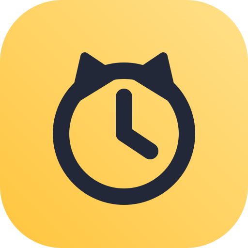

# Niko Clock



Hear the time out loud. Niko Clock is for people who can't easily read a screen: people who can't read, older people and people with low vision. Part of [Niko](https://github.com/NikoApps): simple, free Android apps with no ads and no tracking.

**Status:** early development. Not on F-Droid yet.

## What it does

- Shows the time in very large numbers
- Speaks the time when you press one big button, in the phone's language and voice

## Planned for the first release

- Speak the time when the phone is shaken
- Hourly announcements with quiet hours at night
- Its own volume, so it isn't silenced with media
- The date, including local calendars such as Bikram Sambat and Hijri
- Keeps working through battery savers and reboots

The full spec lives in the project hub.

## Screenshots

Coming soon.

## Building

Requires JDK 17 and the Android SDK.

```sh
./gradlew assembleDebug
```

The theme and speech code in `app/src/main/kotlin/io/github/nikoapps/commons` will move into a shared Niko Commons library when the second Niko app starts.

## Contributing

See the [contributing guide](https://github.com/NikoApps/.github/blob/main/CONTRIBUTING.md). Testing with someone who would actually use the app is the most useful help right now.

## Licence

GNU General Public License v3.0. See [LICENSE](LICENSE).
